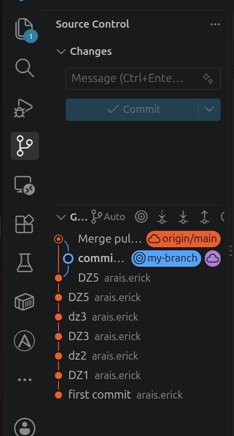

Задание 1

Создайте репозиторий с произвольным названием. Добавьте в него любой файл с кодом и файл README.md с кратким описанием этого кода.

 

Задание 2

Скачайте репозиторий из первого задания себе на компьютер.

Создайте новую ветку и внесите изменения в файл с кодом (или добавьте новый).

Отправьте ветку на сервер GitHub и пройдите процедуру одобрения pull request (сами одобрения можно не ставить или сделать это с любого другого аккаунта).

Объедините изменения в новой ветке с основной.

### Данное задание выполнил в репозитории для ДЗ

